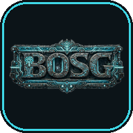

  

<h1 align="center">Descargas de BOSG</h1>

  Instaladores de mis apps y juegos para Windows, Mac y Android. Todo es gratis. 
  Elige una app, descarga el archivo de tu sistema y sigue las instrucciones de instalación.

---

## Apps

| | App | Para | Qué es |
|:-:|---|---|---|
|  | [**Grayskull Garage**](#grayskull-garage) | 🪟 Windows · 🍎 Mac | Inventario de colecciones: Hot Wheels, He-Man y lo que coleccionas |
|  | [**Pensamientos Felices**](#pensamientos-felices) | 🪟 Windows · 🍎 Mac | Juego sobre las distintas caras de la depresión (para adultos) |

<!-- Nuevas apps: agrega una fila aquí y una sección abajo (ver PUBLICAR.md). -->

---

## Grayskull Garage

**Organizador de coleccionables para tu casa.** Registra cada pieza de tu colección con fotos y detalles, y sabe siempre en
qué repisa, vitrina o caja está. Viene preparado para **Hot Wheels** y **He-Man / Masters of the Universe**, y puedes
crear tus propios tipos de colección.

- 📦 Ubicaciones en árbol (cuarto › vitrina › repisa › caja) con historial de movimientos.
- 📷 Varias fotos por pieza, incluso desde la cámara del celular.
- 🔎 Búsqueda, filtros, etiquetas, lista de deseos y detector de duplicados.
- 💰 Precio pagado, valor estimado y totales de la colección.
- 🏛️ Modo museo: tus visitas pueden ver la colección sin poder cambiar nada.
- 💾 Respaldo `.zip` y exportación a Excel.

Se instala en la PC y se usa desde el navegador, también desde el celular conectado al mismo Wi-Fi (con un código QR).
Todo se guarda en tu PC: sin nube y sin cuentas.

<!-- descargas:grayskull-garage:inicio -->
| Sistema | Descarga | Versión |
|---|---|---|
| 🪟 Windows 10 / 11 | [Grayskull-Garage-1.1.0-windows-setup.exe](https://github.com/bosc12/Descargas/releases/download/grayskull-garage-v1.1.0/Grayskull-Garage-1.1.0-windows-setup.exe) | 1.1.0 |
| 🍎 Mac (Apple M1 o más nuevo) | [Grayskull-Garage-1.1.0-mac-arm64.dmg](https://github.com/bosc12/Descargas/releases/download/grayskull-garage-v1.1.0/Grayskull-Garage-1.1.0-mac-arm64.dmg) | 1.1.0 |
<!-- descargas:grayskull-garage:fin -->

[Novedades y versiones anteriores](https://github.com/bosc12/Descargas/releases?q=grayskull-garage&expanded=true)

**Primer uso:** al abrirla aparece un ícono junto al reloj y se abre el navegador para crear la cuenta del dueño. Para
entrar desde el celular, usa la opción *“Abrir en el celular (código QR)”* del ícono. Si Windows pregunta si la app puede
usar la red, acepta en **redes privadas**.

---

## Pensamientos Felices

**Un juego sobre las distintas caras de la depresión.** No busca deprimir: busca que se entienda que la depresión no
siempre se ve como uno espera. Son cinco días en la vida de alguien que trabaja en una oficina, maneja dos horas de
tranque cada mañana y llega a su casa con la cabeza llena.

- 🧠 Una barra de estrés que sube sola, y respiros pequeños que de verdad ayudan.
- 🚗 El tranque de cada mañana, rompecabezas en el carro y un sueño donde hay que sobrevivir.
- 💬 Conversaciones con los compañeros de la oficina: preguntar abre, consolar cierra.
- 🎵 Música original: «Lo cool de ser raros» de Tw-Rapsody, y piano de BOSG.
- 🎚️ Tres niveles: fácil, normal y difícil.
- 🔒 Lo que escribes con tus palabras se queda en tu equipo; no se envía a ningún lado.

**Es para adultos:** trata temas sensibles (depresión, agotamiento, aislamiento, pensamientos intrusivos). No
reemplaza la ayuda profesional. En Panamá, la línea **147** atiende gratis las 24 horas (también por WhatsApp al
6694-2747).

  
   ▶️ <a href="https://www.youtube.com/watch?v=iuBNplnj8MQ"><strong>Ver el tráiler</strong></a>
  &nbsp;·&nbsp; 🕹️ <a href="https://bosg21.itch.io/pensamientos-felices"><strong>También en itch.io</strong></a>

<!-- descargas:pensamientos-felices:inicio -->
| Sistema | Descarga | Versión |
|---|---|---|
| 🪟 Windows 10 / 11 | [Pensamientos-Felices-0.9.0-windows-setup.exe](https://github.com/bosc12/Descargas/releases/download/pensamientos-felices-v0.9.0/Pensamientos-Felices-0.9.0-windows-setup.exe) | 0.9.0 |
| 🍎 Mac (Apple M1 o más nuevo) | [Pensamientos-Felices-0.9.0-mac-arm64.dmg](https://github.com/bosc12/Descargas/releases/download/pensamientos-felices-v0.9.0/Pensamientos-Felices-0.9.0-mac-arm64.dmg) | 0.9.0 |
<!-- descargas:pensamientos-felices:fin -->

[Novedades y versiones anteriores](https://github.com/bosc12/Descargas/releases?q=pensamientos-felices&expanded=true)

**Primer uso:** el juego empieza con un aviso de contenido y te deja elegir si quieres que te haga preguntas
personales. Se juega con teclado y mouse.

---

## Cómo instalar

Mis apps no están firmadas con certificados de pago, así que Windows, Mac y Android muestran un aviso la primera vez.
Es normal; así se abren:

### 🪟 Windows
1. Abre el archivo `.exe` descargado.
2. Si aparece *“Windows protegió tu PC”*, pulsa **Más información › Ejecutar de todas formas**.
3. Sigue el instalador.

### 🍎 Mac
1. Abre el `.dmg` y arrastra la app a la carpeta **Aplicaciones**.
2. Ábrela desde Aplicaciones. Si dice que no se puede verificar al desarrollador, ciérrala y ve a
   **Ajustes del Sistema › Privacidad y seguridad**, baja hasta el aviso de la app y pulsa **Abrir igualmente**.
   (En versiones antiguas de macOS basta con **clic derecho › Abrir**.)
3. Solo hay que hacerlo la primera vez.

### 🤖 Android (archivos `.apk`)
1. Descarga el `.apk` desde el celular.
2. Ábrelo. Si Android lo pide, permite a tu navegador o al gestor de archivos **instalar apps desconocidas**.
3. Pulsa **Instalar**. Si Play Protect avisa, elige **Instalar de todas formas**.

---

Hecho por <strong>BOSG</strong> 🐾

